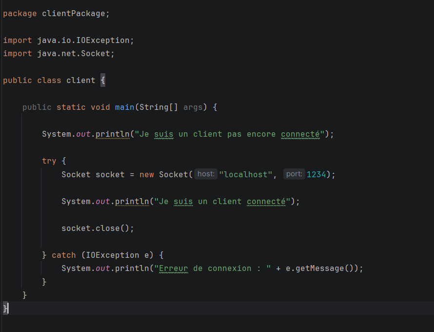
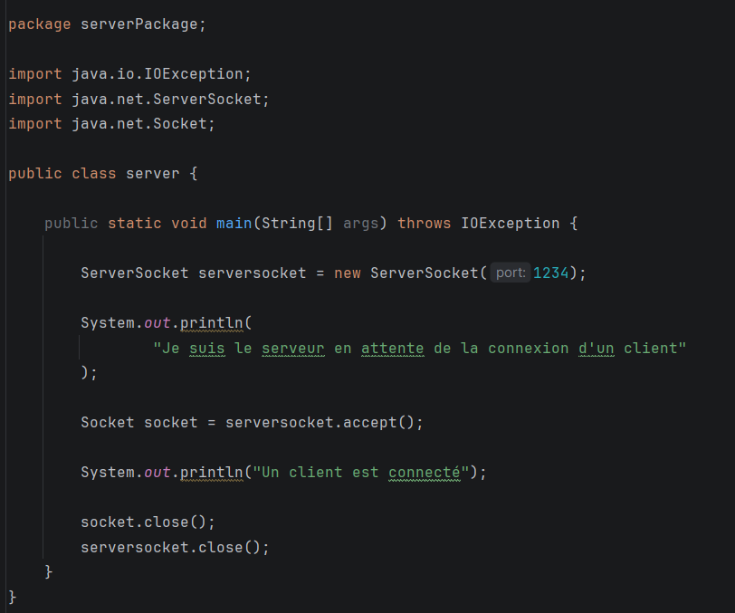
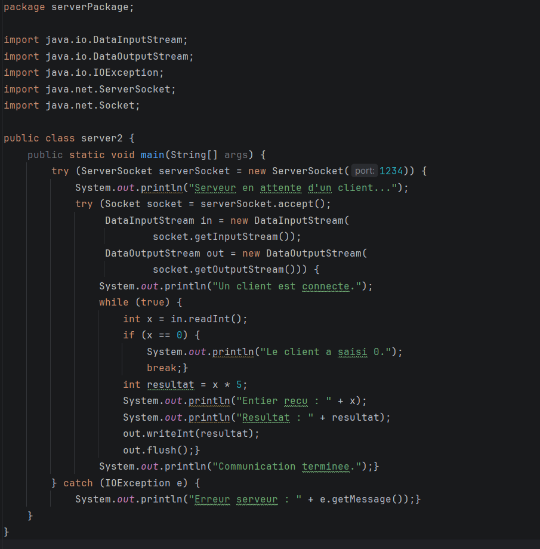
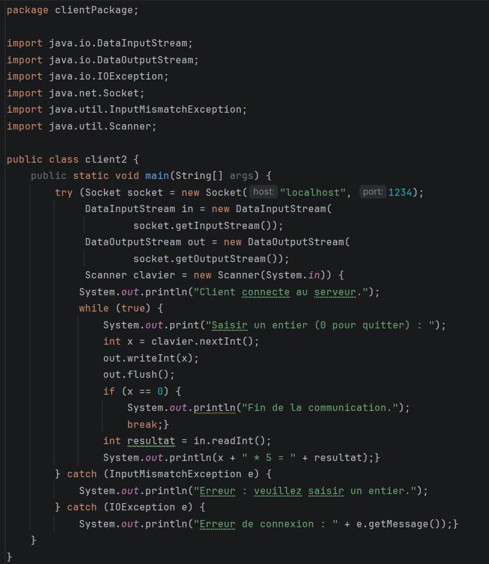
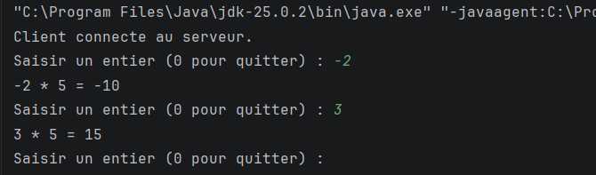
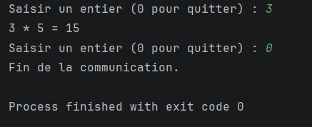
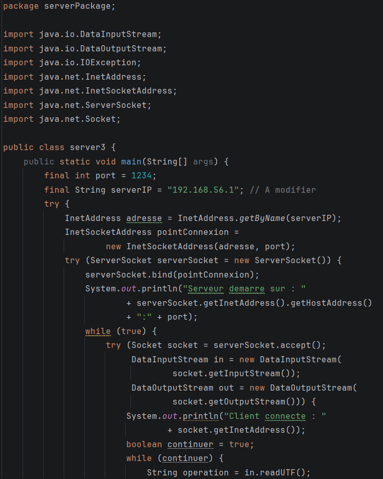
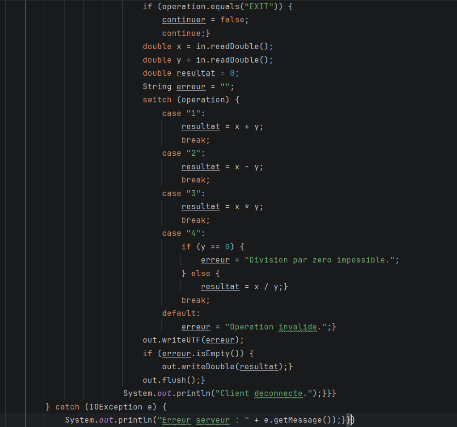
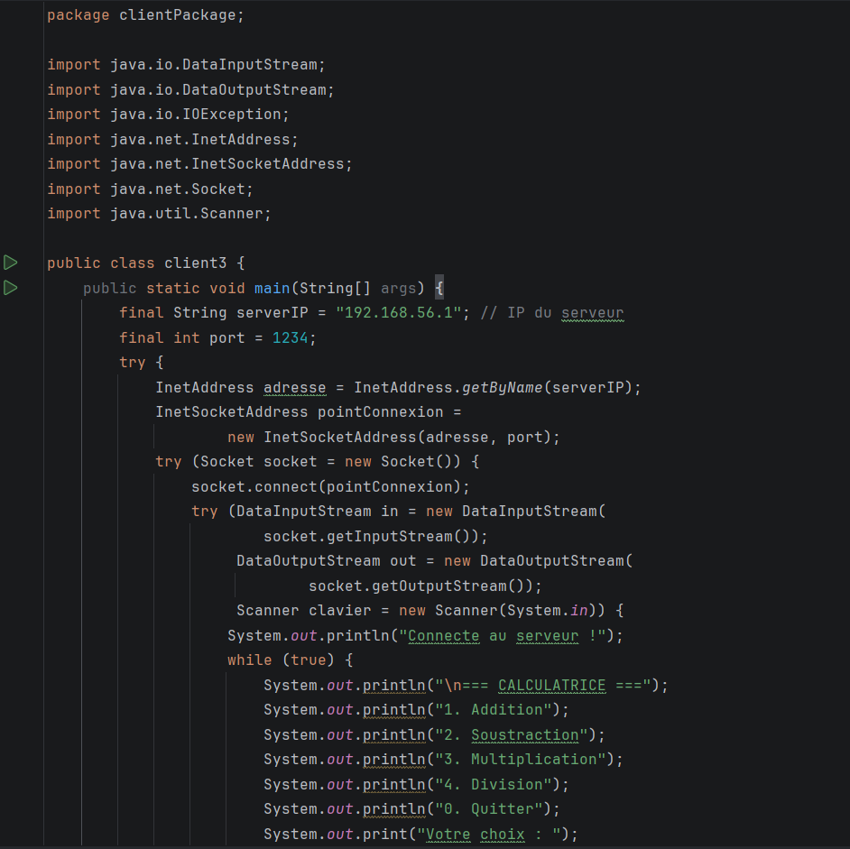
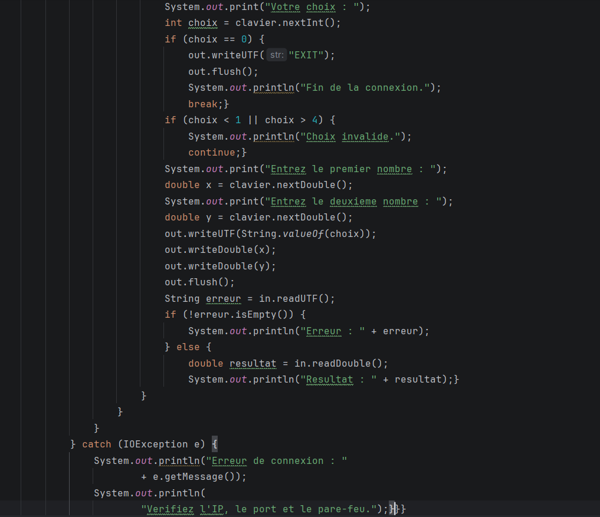

# TP1-DAR2026 — Développement d’applications réparties

## Présentation

Ce dépôt regroupe les trois activités du TP1 du module **Développement d’applications réparties**. Le travail consiste à créer puis à améliorer une application Client/Serveur en Java à l’aide des sockets TCP.

## Objectifs généraux

- Établir une communication entre un client et un serveur.
- Envoyer des données du client vers le serveur et retourner une réponse.
- Réaliser des calculs côté serveur.
- Gérer plusieurs demandes successives et fermer proprement la connexion.
- Connecter deux machines distinctes sur un même réseau local.
- Proposer plusieurs opérations de calculatrice.

## Environnement de travail

- **Java :** JDK 8 ou version supérieure
- **IDE :** IntelliJ IDEA
- **Outils :** GitHub
- **Communication :** sockets TCP (`Socket`, `ServerSocket`)

---

## Activité 1-1 — Création d’une connexion Client/Serveur

### Objectif

Créer deux applications Java distinctes : un serveur qui attend une connexion et un client qui se connecte au serveur. Pour cette première étape, les deux applications sont exécutées sur la même machine avec `localhost`.

### Fonctionnement

1. Le serveur crée un `ServerSocket` sur le port `1234`.
2. Le serveur attend une connexion à l’aide de `accept()`.
3. Le client utilise un `Socket` pour se connecter à `localhost:1234`.
4. Le serveur affiche un message lorsqu’un client est connecté.
5. Les sockets sont fermées à la fin du test.


> Capture 1 — Code du serveur
> 
> Afficher la classe `Server.java`, notamment la création du `ServerSocket` et l’appel à `accept()`.

> Capture 2 — Code du client
> 
> Afficher la classe `Client.java`, notamment l’adresse `localhost` et le port utilisé.

> Capture 3 — Exécution du serveur et du client  
>   
> Montrer le serveur en attente, puis le message confirmant la connexion du client.

### Résultat attendu

Le serveur attend la connexion entrante. Après le lancement du client, le serveur indique qu’un client est connecté et le client affiche que la connexion est établie.

---

## Activité 1-2 — Service de multiplication côté serveur

### Objectif

Étendre l’application précédente afin que le client envoie un entier `x` au serveur. Le serveur calcule `x × 5` puis renvoie le résultat au client.

### Fonctionnement

1. Le client demande à l’utilisateur de saisir un entier.
2. Le client transmet cet entier au serveur.
3. Le serveur lit la valeur avec `DataInputStream`.
4. Le serveur calcule le produit `x * 5`.
5. Le serveur renvoie le résultat avec `DataOutputStream`.
6. Le client lit et affiche le résultat.
7. Le client peut envoyer plusieurs valeurs. La saisie de `0` met fin à la communication et les ressources sont fermées proprement.

### Gestion des entrées/sorties

Les classes `DataInputStream` et `DataOutputStream` permettent de lire et d’écrire des entiers avec `readInt()` et `writeInt()`. Elles permettent notamment de transmettre correctement les nombres négatifs. Le client et le serveur doivent utiliser le même ordre de lecture et d’écriture pour éviter de bloquer la communication.

### Tests à effectuer

| Valeur saisie `x` | Résultat attendu `x × 5` |
|---:|---:|
| `2` | `10` |
| `-3` | `-15` |
| `0` | Fin de la communication |
| `7` | `35` |

> Ces valeurs sont des exemples de tests. Pour vérifier plusieurs saisies dans une même session, saisir des valeurs comme `2`, `-3`, `7`, puis `0`.


> Capture 4 — Code du client avec saisie et flux de données 
> 
> Montrer la saisie de l’entier, l’envoi au serveur et la réception du résultat.

> Capture 5 — Code du serveur avec multiplication
>   
> Montrer la lecture de l’entier, le calcul `x * 5` et l’envoi du résultat.
> 
> Capture 6 — Tests avec valeurs positives et négatives  
>   
> Afficher les valeurs saisies et les résultats correspondants, y compris une valeur négative.

> Capture 7 — Arrêt avec zéro
>   
> Montrer la saisie de `0` et la fin propre de la communication.

### Interprétation

Le calcul est exécuté côté serveur, tandis que le client se limite à envoyer la valeur et à afficher la réponse. Les résultats des nombres positifs et négatifs doivent respecter la multiplication par cinq. La valeur `0` sert de signal d’arrêt et ne doit pas entraîner une nouvelle opération.

---

## Activité 1-3 — Connexion entre deux machines et calculatrice améliorée

### Étape 1 — Connexion sur deux machines distinctes

#### Objectif

Adapter l’application afin que le client se connecte à un serveur exécuté sur une autre machine du même réseau local.

#### Principe

- Le serveur doit écouter sur l’adresse IP locale de sa machine et sur un port choisi.
- Le client doit utiliser l’adresse IP réelle de la machine serveur à la place de `localhost`.
- Les classes `InetAddress` et `InetSocketAddress` permettent de représenter et de gérer l’adresse IP et le port.
- Le pare-feu doit autoriser la communication sur le port choisi.
- Les deux machines doivent pouvoir communiquer sur le réseau local.

**À adapter dans le code :** remplacer l’adresse d’exemple ci-dessous par l’adresse IP réelle de la machine serveur. Ne pas conserver une adresse fictive dans la version finale.

```java
// Exemple de principe côté client
String adresseServeur = "192.168.1.10"; // À remplacer par l'IP réelle
int port = 1234;
```

> **Important :** `192.168.1.10` est uniquement une adresse d’exemple. Elle ne représente pas nécessairement l’adresse de votre serveur. Si vous utilisez une machine virtuelle, configurez son réseau pour que le client puisse joindre son adresse IP.


> **Capture 8 — Adresse IP du serveur**  
>   
> Montrer l’adresse IP locale de la machine ou de la machine virtuelle qui exécute le serveur.

> **Capture 9 — Configuration réseau du serveur**  
>   
> *Montrer l’utilisation de l’adresse IP et du port dans la configuration du serveur.*

> **Capture 10 — Connexion du client à l’adresse IP du serveur**  
>   
> *Montrer l’adresse IP du serveur configurée côté client.*

> **Capture 11 — Test de connexion entre les deux machines**  
>   
> *Montrer le serveur et le client exécutés séparément, avec la connexion établie.*

### Étape 2 — Calculatrice avec quatre opérations

#### Objectif

Améliorer le service de calcul en permettant au client de choisir une opération parmi :

1. Addition
2. Soustraction
3. Multiplication
4. Division

#### Fonctionnement attendu

1. Le client affiche un menu d’opérations.
2. L’utilisateur choisit une opération et saisit les valeurs nécessaires.
3. Le client transmet le choix et les opérandes au serveur.
4. Le serveur effectue l’opération demandée.
5. Le serveur renvoie le résultat.
6. Le client affiche le résultat reçu.

**Point à prévoir :** le programme doit gérer la division par zéro et les choix de menu invalides. Le format et l’ordre des données envoyées par le client doivent correspondre exactement à ceux attendus par le serveur.


## Organisation conseillée du dépôt

```text
TP1-DAR2026/
├── README.md
├── src/
│   ├── clientPackage/
│   │   └── Client.java
│   └── serverPackage/
│       └── Server.java
└── captures/
    ├── activite-1-1-serveur-code.png
    ├── activite-1-1-client-code.png
    ├── activite-1-1-execution.png
    ├── activite-1-2-client-code.png
    ├── activite-1-2-serveur-code.png
    ├── activite-1-2-tests.png
    ├── activite-1-2-arret-zero.png
    ├── activite-1-3-ip-serveur.png
    ├── activite-1-3-serveur-code.png
    ├── activite-1-3-client-code.png
    ├── activite-1-3-test-reseau.png
    ├── activite-1-3-menu.png
    ├── activite-1-3-calculs-serveur.png
    ├── activite-1-3-tests-calculatrice.png
    └── activite-1-3-erreurs.png
```

Les noms des fichiers de captures sont des exemples : vous pouvez garder ces noms ou modifier les liens Markdown pour correspondre aux noms de vos images.

## Dépôt sur GitHub

Après avoir ajouté le code, le README et les captures d’écran :

```bash
git add .
git commit -m "Complete TP1 activities 1-1, 1-2 and 1-3"
git push
```

Copier ensuite le lien du dépôt GitHub et le déposer sur la plateforme ENT.

## Conclusion

Ce TP permet de comprendre progressivement la communication Client/Serveur en Java avec TCP : établissement d’une connexion, échange d’entiers, traitement côté serveur, gestion de plusieurs requêtes, connexion entre deux machines et ajout de services de calcul. Les captures d’écran finales doivent montrer les tests réellement effectués dans l’environnement de travail.
